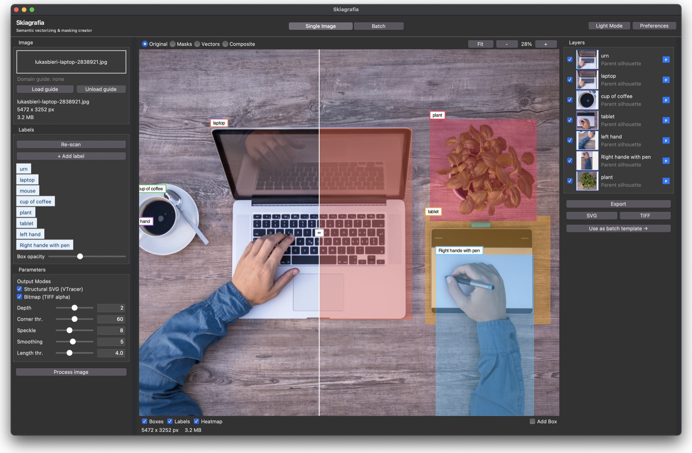

# Skiagrafia

> **Semantic Vectorizing and Masking Creator**
>
> A desktop application for AI-powered image segmentation, masking, and vectorization.

[](https://github.com/tsevis/skiagrafia)
[](https://www.python.org/downloads/)
[](https://support.apple.com/en-us/116943)
[](FILE_STRUCTURE.md)
[](LICENSE)

**Skiagrafia** uses local ML models to segment images into semantic layers
(objects and their parts), producing vector (SVG) and bitmap (TIFF/PNG)
outputs. It is designed for designers and production workflows: model
inference stays on the machine, and VLM services are restricted to loopback
endpoints.

<p align="center">
  
</p>

---

## Quick Start

```bash
# Clone and install
git clone https://github.com/tsevis/skiagrafia.git && cd skiagrafia
# Creates the locked Python 3.13 project environment
uv sync --locked --group dev

# VLM backend, option A — Ollama (default)
ollama serve &
ollama pull qwen2.5vl:3b

# VLM backend, option B — llama.cpp server (OpenAI-compatible API)
llama-server -hf Qwen/Qwen3-VL-8B-Instruct-GGUF:Q4_K_M --port 8080 -c 8192

# Run the application
./run.sh

# …or run a folder without a window
skiagrafia PAGES --output OUT --limit 3     # rehearse on three images first
skiagrafia PAGES --output OUT --detach      # then the whole folder
```

When the app starts (`./run.sh` or `main.py`; the `skiagrafia` command has
no wizard), a **setup wizard** opens if a required component is missing or
the check cannot complete: the core fallback weights (GroundingDINO, SAM 2.1,
VitMatte and Grounded-SAM-2 source), the selected VLM backend, or a required
Ollama model. Its **Download missing** button fetches the missing registry
weights into the models directory (never the local backend's GGUF files)
and, on the Ollama backend, also pulls the missing required and
recommended Ollama models (see [Model licences](#model-licences)). Machines
that already have every required component skip the wizard. MLX SAM 3 is an optional, separately verified local
bundle; its exact on-disk layout is described under [Model Weights](#model-weights).

📖 **New here? Read the [User Manual](docs/MANUAL.md).**

---

## Table of Contents

1. [Overview](#overview)
2. [Features](#features)
3. [System Requirements](#system-requirements)
4. [Installation](#installation)
5. [VLM Backends](#vlm-backends)
6. [Operating Modes](#operating-modes)
7. [Architecture](#architecture)
8. [ML Pipeline](#ml-pipeline)
9. [Configuration](#configuration)
10. [Output Formats](#output-formats)
11. [API Reference](#api-reference)
12. [Troubleshooting](#troubleshooting)
13. [Model licences](#model-licences)
14. [License](#license)

---

## Overview

Skiagrafia addresses a common challenge in design and production workflows: converting raster images into clean, layered vector artwork with precise masks. Traditional approaches require manual tracing and masking — time-consuming and error-prone. Skiagrafia automates the process with machine learning models running on your machine.

### Key Capabilities

- **Semantic Understanding** — automatically identifies objects and their constituent parts (e.g., a monitor with screen, stand, and bezel)
- **Local VLM Backends** — Ollama, an existing llama.cpp server, or an
  app-managed offline llama.cpp server, switchable in Preferences
- **Precision Segmentation** — MLX SAM 3 text-to-instance masks on Apple
  Silicon, with GroundingDINO + SAM 2.1 fallback
- **Alpha Matting** — VitMatte refinement for hair, fur, and soft edges
- **Vector Output** — VTracer converts bitmaps to clean SVG paths
- **Batch Processing** — process thousands of images with a wizard-driven workflow
- **First-Run Bootstrap** — fresh installs can download the core fallback
  weights; an optional MLX SAM 3 bundle is verified in place

---

## Features

### Single Image Mode

- Interactive designer workflow with live preview
- Drag-and-drop image import
- Real-time layer visualization
- Iterative refinement with adjustable parameters
- Export to SVG, TIFF, PNG, and PDF

### Batch Mode

- Six-step wizard for production pipelines
- Process large image folders with a guided workflow
- Human-in-the-loop label triage (mandatory gate)
- Saved batch setups for editable reruns
- Template system for reusable configurations
- Progress tracking and error recovery
- Output separated by format: `svg/` and `tiff/` under each run
- Runs resume: images already finished are skipped on a re-run
- A dead worker costs the image it was holding, not the rest of the queue
- A command line for the same pipeline, with no window

### ML Pipeline (10-step)

- **Qwen2.5-VL / Qwen3-VL** — semantic interrogation via Ollama or llama.cpp, with dual-prompt strategy and fallback chain
- **MLX SAM 3** — primary text-to-instance masks with reusable image features
- **GroundingDINO + SAM 2.1** — robust fallback and manual-box segmentation
- **VitMatte** — high-quality alpha matting
- **VTracer** — bitmap-to-SVG spline fitting

### Domain Guides

- TOML-based knowledge packs that teach the VLM which objects to look for
- Built-in GUI editor inside Preferences (Domain Guides tab)
- Canonical names, aliases, detector phrases, and child parts per object
- Live TOML preview as you edit
- Batch defaults (preferred VLM, tiling, fallback chain) per domain
- `closed_vocabulary` makes the listed objects the only terms a model may
  propose; anything else is refused and named, rather than dropped quietly
- Aliases name an object, generic terms and detector phrases only find it

### Technical

- Contract-based architecture with Protocol interfaces
- Dependency injection via CapabilitySet
- User-configurable model directory
- Apple Silicon optimized (MPS and MLX acceleration)
- Lazy model loading with memory residency
- ProcessPoolExecutor parallelization
- SQLite state persistence (JSON records, no pickle)
- SHA-256 verification of a downloaded model before it is installed
- Typed throughout: pyright, ruff and a CVE audit gate every pull
  request, every push to `main`, and a nightly run

---

## System Requirements

### Hardware

| Requirement | Minimum | Recommended |
|-------------|---------|-------------|
| **Platform** | Apple Silicon Mac | M1 Ultra or better |
| **Memory** | 32 GB | 64–128 GB unified memory |
| **Storage** | 20 GB free | 50 GB for model weights |
| **GPU** | MPS capable | Metal Performance Shaders |

### Software

- **macOS** 12.0 (Monterey) or later
- **Python** 3.13 (the locked project runtime; use `uv sync --locked`)
- **One local VLM backend**:
  - [Ollama](https://ollama.com) at `http://localhost:11434` (default), or
  - an existing [llama.cpp](https://github.com/ggml-org/llama.cpp) `llama-server` at `http://localhost:8080`, or
  - the app-managed offline llama.cpp mode using already cached model files

### Model Weights

Core fallback weights are downloadable by the first-run wizard (or
Preferences → Models → Download missing). MLX SAM 3 is a separately verified
local bundle:

| Model | Source | Size |
|-------|--------|-----:|
| Grounded-SAM-2 source (code + configs) | GitHub archive | ~30 MB |
| GroundingDINO SwinT-OGC | official release | ~660 MB |
| SAM 2.1 Hiera Large | official release | ~900 MB |
| MLX SAM 3 source + checkpoint (optional primary backend) | local verified model bundle | varies |
| VitMatte ViT-B Composition-1K | HuggingFace | ~380 MB |
| Qwen2.5-VL 3B (`qwen2.5vl:3b`) | Ollama pull | ~3.2 GB |
| Gemma 4 E4B (`gemma4:e4b`) — fallback + reasoner | Ollama pull | ~9.6 GB |
| Qwen3-VL 8B GGUF — llama.cpp alternative | llama.cpp `-hf` cache | ~6.5 GB |

**Download integrity.** Every download is restricted to an allow-listed host
over HTTPS, and a registry entry may additionally pin an immutable SHA-256
that is checked before the file is moved into place; a mismatch is discarded
and reported. Only `vitmatte-base-composition-1k` is pinned today, because it
is the only one of these whose publisher provides a digest to pin it to.
`groundingdino_swint_ogc.pth` and `sam2.1_hiera_large.pt` are served without
one, and the Grounded-SAM-2 source archive tracks a moving branch, so no
fixed digest can describe it. Hashing the copies already on a given machine
would record whatever those copies are, which is trust-on-first-use rather
than an integrity check, so it is not done. See
[FILE_STRUCTURE.md](FILE_STRUCTURE.md#operational-limits).

With the default **Segmentation: auto** setting, MLX SAM 3 activates only
when both its local source and checkpoint are present. The model library must
contain this shape (the model bundle is not downloaded or moved by the
wizard):

```text
<models_directory>/
└── mlx_sam3/
    ├── sam3/                         # bundled Python source package
    └── sam3-mod-weights/
        └── model.safetensors
```

If the bundle is absent or fails to initialize, Skiagrafia reports the
condition and uses GroundingDINO + SAM 2.1 instead. MLX SAM 3 currently
requires the locked `mlx==0.31.2` runtime contract.

**Default models folder.** Earlier versions used a shared model library from
a fixed location on the author's machine whenever it existed; that lookup is
gone. The default is now `~/Library/Application Support/skiagrafia/models/`
(macOS) or `~/.local/share/skiagrafia/models/` (Linux), unless
`SKIAGRAFIA_EXTRA_MODEL_DIRS` lists an existing directory: one or more
absolute paths (a leading `~` is expanded) separated by `:`, the first that
exists wins, and relative, unresolvable or unreadable entries are
ignored with a log warning. To keep using an existing library, choose it in Preferences → Models
(saved in the preferences file, takes precedence over the variable, and works
for an app started from the Dock or Finder) or export the variable before
`./run.sh`. A Dock or Finder launch does not read shell profiles such as
`~/.zshrc`; for that case set the variable for the login session with
`launchctl setenv SKIAGRAFIA_EXTRA_MODEL_DIRS <directory>` and then start the
app.

---

## Installation

### 1. Clone and Install

```bash
git clone https://github.com/tsevis/skiagrafia.git
cd skiagrafia
uv sync --locked --group dev
```

### 2. Set Up a VLM Backend

**Option A — Ollama (default):**

```bash
brew install ollama
ollama serve

ollama pull qwen2.5vl:3b      # primary VLM (required)
ollama pull gemma4:e4b        # fallback VLM + text reasoner (recommended)
ollama pull minicpm-v         # second fallback (optional)
```

**Option B — llama.cpp server:**

```bash
brew install llama.cpp

# Start with a multimodal model (cached after the first download)
llama-server -hf Qwen/Qwen3-VL-8B-Instruct-GGUF:Q4_K_M --port 8080 -c 8192
```

### 3. First Launch

```bash
./run.sh
```

The setup wizard opens automatically **only if something is missing**: it
lists every required component with its size, downloads the weights, and can
pull the Ollama models. The models directory defaults to the first existing
directory in `SKIAGRAFIA_EXTRA_MODEL_DIRS` (see [Model Weights](#model-weights))
when that variable is set, otherwise
`~/Library/Application Support/skiagrafia/models/` — configurable in
Preferences → Models.

---

## VLM Backends

Semantic interrogation runs on one of three interchangeable local backends,
selected in **Preferences → Models → VLM backend**:

| | Ollama | llama.cpp server | Managed local llama.cpp |
|---|---|---|---|
| API | Ollama HTTP | OpenAI-compatible `/v1/chat/completions` | App-owned local server |
| Default URL | `http://localhost:11434` | `http://localhost:8080` | allocated loopback port |
| Default model | `qwen2.5vl:3b` | whatever the server has loaded | Qwen3-VL 8B from local cache |
| Fallback chain | `gemma4:e4b` → `minicpm-v` | — (one loaded model) | local Gemma fallback |
| Text reasoner | `gemma4:e4b` | the same loaded model | local Gemma fallback |

Notes on llama.cpp:

- One server hosts **one** loaded model; the model name in preferences is informational.
- Vision requires a model with a multimodal projector (mmproj) — e.g. `Qwen/Qwen3-VL-8B-Instruct-GGUF`.
- Use `-c 8192` — the server's default context can exhaust Metal GPU memory on vision models.
- The server answers HTTP 503 while loading; the app's health check handles this.

The managed local option never downloads model files: it starts only an
app-owned `llama-server` using verified GGUF/mmproj pairs already in the local
Hugging Face cache.

---

## Operating Modes

### Single Image Workflow

1. **Drop an image** onto the canvas area
2. **Scan** — the VLM analyzes the image and proposes labels
3. **Review labels** — confirm, adjust, or add objects
4. **Process** — run the 10-step pipeline to generate masks
5. **Export** — SVG, TIFF, PNG, or PDF

### Batch Workflow

1. **Import** — select a folder or load a template
2. **Configure** — output options, VTracer parameters, interrogation settings
3. **Interrogate** — the VLM scans all images (parallel)
4. **Triage** — review and confirm labels (mandatory gate)
5. **Process** — run the full pipeline on all images
6. **Output** — review SVG/layer metrics and foreground `all-objects` TIFFs,
   export either bundle to a chosen folder, and retry only failed inputs

### Command Line

The same pipeline with no window, for folders too large to sit in front of.

```bash
skiagrafia PAGES --output OUT [options]
```

| Option | What it does |
| --- | --- |
| `--labels a,b` | separate these labels. Omit it and the VLM is asked what is in each image |
| `--guide g.toml` | a Domain Guide naming the objects and their terms |
| `--limit N` | process only the first N images |
| `--detach` | run in a session of its own and print the process id |
| `--output-mode` | what a run produces (default `vector+bitmap`) |
| `--quiet` | errors only |

**Rehearse before you commit.** `--limit 3` costs minutes and is how most
faults in a long run are found — a label set that comes back empty, a guide
that refuses more than expected, a layer count far from what you wanted.

**Runs resume.** Images already finished in the destination are skipped, so
re-running after an interruption picks up where it stopped. Exit codes: `0`
clean, `1` the run lost images, `2` nothing had a label to separate.

**Long runs want `--detach`.** It uses a double fork and `setsid` rather than
`nohup`, which only ignores SIGHUP: a terminal torn down as a process group
takes its jobs with it.

See the [User Manual](docs/MANUAL.md) for a full walkthrough of the windowed
modes.

---

## Architecture

v5.2 implements contract-based dependency injection with five capability protocols:

```
┌─────────────────────────────────────────────────────────────────┐
│                     UI Layer                                    │
│  main_window.py · left_panel.py · canvas_panel.py               │
│  step_progress.py · batch_runner.py                             │
│                                                                 │
│  Reads preferences → builds concrete clients → injects          │
└────────────────────────┬────────────────────────────────────────┘
                         │ build_capabilities(prefs)
                         ▼
┌─────────────────────────────────────────────────────────────────┐
│              Factory (factory.py)                               │
│  build_interrogation_settings() · build_capabilities()          │
│  All "which model, which path, which threshold" decisions.      │
└────────────────────────┬────────────────────────────────────────┘
                         │ returns CapabilitySet
                         ▼
┌─────────────────────────────────────────────────────────────────┐
│              Capability Protocols (contracts.py)                │
│  Interrogator · Detector · Segmenter · AlphaRefiner ·           │
│  Vectorizer                                                     │
└────────────────────────┬────────────────────────────────────────┘
                         │ implemented by
                         ▼
┌─────────────────────────────────────────────────────────────────┐
│              Concrete Model Clients (models/)                   │
│  vlm_client.py · grounded_sam.py · vitmatte_refiner.py          │
│                                                                 │
│  Each receives its model path from ModelManager.                │
└────────────────────────┬────────────────────────────────────────┘
                         │ paths resolved by
                         ▼
┌─────────────────────────────────────────────────────────────────┐
│              ModelManager (model_manager.py)                    │
│  User-configurable models_dir from preferences.                 │
│  Registry of known models with download URLs.                   │
└─────────────────────────────────────────────────────────────────┘
```

### Capability Protocols

| Protocol | Method | Concrete Implementation |
|----------|--------|------------------------|
| `Interrogator` | `interrogate()` | `GuidedInterrogator` (Ollama / llama.cpp VLM + fallbacks) |
| `Detector` | `detect_box()` | `MLXSAM3` in `auto` when available; `GroundedSAM` fallback |
| `Segmenter` | `segment()`, `clear_cache()` | `MLXSAM3` native instances with `GroundedSAM` / SAM 2.1 fallback |
| `AlphaRefiner` | `predict()` | `VitMatteRefiner` |
| `Vectorizer` | `trace()` | `VTracerVectorizer` |

See [FILE_STRUCTURE.md](FILE_STRUCTURE.md) for the complete module map.

---

## ML Pipeline

The `Orchestrator` executes a 10-step structural pipeline:

```
Step 1:  Load oriented source image as RGB plus any existing alpha
Step 2:  VLM interrogation — get parents, filter against confirmed labels,
         get children per confirmed parent
Step 3:  Instance detection — MLX SAM 3 text-to-instance masks when its
         verified bundle is available; otherwise GroundingDINO boxes
Step 4:  Parent mask construction — native MLX masks or SAM 2.1 from a box;
         scan-stage dedup (IoU + containment) and mask tightening
Step 5:  Child segmentation — crop region, detect + segment per child,
         child mask validation, boolean-subtract children from parent body
Step 6:  Coordinate remapping — child masks from crop space to image space
Step 7:  VitMatte alpha refinement — soft alpha matte per layer, 4-ch TIFF
Step 8:  Mask cleanup — bilateral filter, morphological close, despeckle
Step 9:  VTracer vectorization — bitmap-to-SVG spline fitting per mask
Step 10: SVG assembly — group paths by layer hierarchy, write final SVG
```

### VLM Interrogation Detail

The `GuidedInterrogator` escalates through stages until it has confident labels:

1. **Composition pass** — whole-scene understanding first
2. **Primary pass** — direct object listing (`qwen2.5vl:3b` by default)
3. **Guided pass** — domain-guide exemplars injected into the prompt
4. **Fallback VLMs** — `gemma4:e4b`, then `minicpm-v` (Ollama backend only)
5. **Tiled pass** — quadrant crops for small objects
6. **Reasoner ranking** — `gemma4:e4b` ranks and refines detector phrases

Profiles: `fast` (skip reasoner, 1 child query) · `balanced` (default) · `deep` (always reason, 5 child queries).

---

## Configuration

### Preferences File

`~/.config/skiagrafia/preferences.json` — managed by the Preferences window:

```json
{
    "vlm_backend": "ollama",
    "ollama_url": "http://localhost:11434",
    "ollama_model": "qwen2.5vl:3b",
    "llamacpp_url": "http://localhost:8080",
    "llamacpp_model": "Qwen3-VL-8B-Instruct",
    "preferred_fallback_vlm": "gemma4:e4b",
    "preferred_text_reasoner": "gemma4:e4b",
    "models_directory": "",
    "segmentation_backend": "auto",
    "sam3_confidence": 0.2,
    "output_directory": "~/Desktop/skiagrafia_out",
    "sam_box_threshold": 0.35,
    "sam_text_threshold": 0.25,
    "interrogation_profile": "balanced",
    "interrogation_fallback_mode": "adaptive_auto"
}
```

Legacy shipped defaults are migrated once on load: `moondream` and `qwen3.5`
VLM names, `sam2` to checkpoint-aware `auto`, and the former SAM 3 confidence
default `0.5` to `0.2`. Deliberate custom model choices are never changed.

### Environment Variables

`run.sh` sets these (recommended way to launch):

```bash
export HF_HUB_OFFLINE=1                  # force local inference
export TRANSFORMERS_OFFLINE=1
export HF_DATASETS_OFFLINE=1
export USE_TF=0 USE_FLAX=0               # no TensorFlow/Flax imports
export PYTORCH_ENABLE_MPS_FALLBACK=1     # MPS fallback for unsupported ops
export PYTHONDONTWRITEBYTECODE=1
export DYLD_FALLBACK_LIBRARY_PATH="/opt/homebrew/lib"   # cairo for PDF export
```

---

## Output Formats

| Format | Contents |
|--------|----------|
| **SVG** | Layered vector paths grouped by parent/child hierarchy |
| **TIFF** | 4-channel (RGBA) bitmap per layer with alpha matte, plus an `all-objects` foreground union for every processed image |
| **PNG** | Flattened preview or per-layer export |
| **PDF** | Vector output via cairosvg (requires Homebrew libcairo) |

GUI batches write `run.json`, `interrogation.json`, `triage.json`, and an
immutable `processing.json` under `<output_dir>/<batch_id>/`. The processing
manifest freezes the exact source paths, guide copy, per-image Triage labels,
selection policies, and effective BatchRunner configuration. Completed output
paths and layer metrics live in `state.db`. The GUI offers Resume only when
these artifacts validate together; otherwise a saved run is restored only as a
new editable batch that must be interrogated and triaged again.

---

## API Reference

### Building a pipeline programmatically

```python
from core.factory import build_capabilities
from core.orchestrator import Orchestrator
from utils.preferences import load_preferences

prefs = load_preferences()
caps = build_capabilities(prefs)
orchestrator = Orchestrator(capabilities=caps)
result = orchestrator.process("photo.jpg", confirmed_labels=["monitor"], manual_detections=None)
```

### Interrogation only

```python
from core.factory import build_interrogation_settings
from core.interrogation import GuidedInterrogator, InterrogationSettings
from utils.preferences import load_preferences

# Preferred: derive settings from preferences (backend-aware)
settings = build_interrogation_settings(load_preferences())

# Or construct explicitly — e.g. against a llama.cpp server:
settings = InterrogationSettings(
    host="http://localhost:8080",
    primary_vlm="Qwen3-VL-8B-Instruct",
    fallback_vlms=[],               # one server = one loaded model
    reasoner_model="Qwen3-VL-8B-Instruct",
    backend="llamacpp",             # or "ollama"
)

interrogator = GuidedInterrogator(settings)
result = interrogator.interrogate(image_array)
for candidate in result.candidates:
    print(candidate.canonical_label, candidate.detector_phrases, candidate.confidence)
```

### Talking to a VLM directly

```python
from models.vlm_client import create_vlm_client

client = create_vlm_client("llamacpp", "http://localhost:8080", "Qwen3-VL-8B-Instruct")
if client.health_check():
    labels = client.get_parents(image_array)          # list[str]
    reply = client.query_text("Rank these labels…")   # str
```

---

## Troubleshooting

### Ollama connection failed

```bash
ollama serve                        # verify Ollama is running
ollama pull qwen2.5vl:3b            # check the model is pulled
curl http://localhost:11434/api/tags
```

### llama.cpp server not ready

```bash
# Start with a multimodal model and a bounded context
llama-server -hf Qwen/Qwen3-VL-8B-Instruct-GGUF:Q4_K_M --port 8080 -c 8192

curl http://localhost:8080/health     # 503 while loading → {"status":"ok"} when ready
curl http://localhost:8080/v1/models  # confirm the loaded model
```

Vision requires a model with a multimodal projector (mmproj); text-only GGUFs
fail on images. If requests return "Compute error", another model may be
holding GPU memory (check `ollama ps`) — free it and restart the server.

### A download fails an integrity check

```
Integrity check failed for pytorch_model.bin: expected sha256 ..., got ...
```

The file that arrived is not the one the registry pins. It is discarded
rather than installed, so nothing partial is left behind. Retry first — a
truncated transfer looks the same. If it repeats, the copy being served no
longer matches the digest recorded from the publisher, and the download
should not be trusted until that is explained.

### Model weights missing

1. Check the models directory in Preferences → Models
2. Use the first-run wizard or **Download missing**
3. Fresh-install default: `~/Library/Application Support/skiagrafia/models/`

### Slow inference on Apple Silicon

```bash
export PYTORCH_ENABLE_MPS_FALLBACK=1
./.venv/bin/python -c "import torch; print(torch.backends.mps.is_available())"
```

### MLX SAM 3 is unavailable

1. Confirm that **Preferences → Pipeline → Segmentation** is `auto` or
   `mlx-sam3`.
2. Check the bundle layout under the configured models directory, especially
   `mlx_sam3/sam3-mod-weights/model.safetensors`.
3. Recreate the project environment with `uv sync --locked --group dev`; do
   not substitute a newer MLX release for the pinned `mlx==0.31.2` without a
   verified model-bundle update.
4. `auto` remains usable without the bundle: it falls back to GroundingDINO +
   SAM 2.1.

### PDF export fails

```bash
brew install cairo libffi
export DYLD_FALLBACK_LIBRARY_PATH="/opt/homebrew/lib"
```

### Drag-and-drop not working

Install `tkinterdnd2` (`pip install tkinterdnd2`); the app falls back to
click-to-browse when it is unavailable.

---

## Model licences

This repository contains no model weights. Each model below is a separate work
under its own terms, which are not covered by the MIT licence of this code. The
table records what each linked source states, read on 2026-10-09. It is
information, not legal advice: read the full text before commercial use or ask
the authors.

| Model | What Skiagrafia uses it for | Licence as the source states it | Source |
|---|---|---|---|
| Qwen2.5-VL 3B Instruct (`qwen2.5vl:3b`) | Default primary VLM on the Ollama backend; required by the setup wizard (`core/factory.py`, `utils/bootstrap.py`) | Upstream: Qwen Research License Agreement ("Non-Commercial" means "research or evaluation purposes only"). Ollama licence file: Apache License 2.0. Not settled, see notes | [Hugging Face LICENSE](https://huggingface.co/Qwen/Qwen2.5-VL-3B-Instruct/blob/main/LICENSE), [Ollama](https://ollama.com/library/qwen2.5vl:3b) |
| Gemma 4 E4B (`gemma4:e4b`) | Default fallback VLM and text reasoner on the Ollama backend; recommended by the wizard (`core/factory.py`, `utils/bootstrap.py`) | Apache-2.0 | [Hugging Face card](https://huggingface.co/google/gemma-4-E4B-it), [Gemma 4 licence](https://ai.google.dev/gemma/docs/gemma_4_license), [Ollama](https://ollama.com/library/gemma4:e4b) |
| Gemma 4 12B (`gemma4:12b`) | Ollama tag that `core/factory.py` maps to `gemma-4-12B-it` on the local backend; on Ollama only if typed in Preferences | Apache License 2.0 (Ollama licence file) | [Ollama](https://ollama.com/library/gemma4:12b), [Hugging Face card](https://huggingface.co/google/gemma-4-12B-it) |
| MiniCPM-V 2.6 (`minicpm-v`) | Second fallback VLM on the Ollama backend, always in the fallback pool; recommended by the wizard; offered in the model lists, but an old saved `minicpm-v` Ollama fallback VLM is replaced by `gemma4:e4b` once per preferences file (`core/factory.py`, `utils/bootstrap.py`, `utils/preferences.py`) | Ollama licence file: MiniCPM Model Community License, which says community use "must comply with Apache 2.0 and the 'MiniCPM Model Community License Agreement'". Hugging Face card: code Apache-2.0, weights under the MiniCPM Model License; the Hugging Face repository is gated (automatic approval) | [Ollama](https://ollama.com/library/minicpm-v), [Hugging Face card](https://huggingface.co/openbmb/MiniCPM-V-2_6) |
| Moondream (`moondream`) | Selectable in the Ollama model name, fallback VLM and batch text reasoner lists (`ui/preferences/preferences_window.py`, `ui/preferences/guide_editor.py`, `ui/batch/steps/step_configure.py`); an old saved `moondream` Ollama model name is replaced by `qwen2.5vl:3b` once per preferences file (`utils/preferences.py`) | apache-2.0 (Hugging Face); Apache License 2.0 (Ollama licence file) | [Hugging Face card](https://huggingface.co/vikhyatk/moondream2), [Ollama](https://ollama.com/library/moondream) |
| LLaVA 1.6 7B, Mistral base (`llava:7b`) | Offered in `ui/batch/steps/step_configure.py`, `ui/preferences/guide_editor.py` and `ui/preferences/preferences_window.py` | Apache License 2.0 (Ollama licence file); apache-2.0 (Hugging Face card of the Mistral variant) | [Ollama tags](https://ollama.com/library/llava/tags), [Hugging Face card](https://huggingface.co/liuhaotian/llava-v1.6-mistral-7b), [LLaVA README](https://github.com/haotian-liu/LLaVA/blob/main/README.md) |
| Llama-Krikri 8B Instruct (`ilsp/llama-krikri-8b-instruct`) | Offered in the Ollama text reasoner list (`ui/preferences/preferences_window.py`) | llama3.1 (Hugging Face card); the Ollama tag has no licence file | [Hugging Face card](https://huggingface.co/ilsp/Llama-Krikri-8B-Instruct), [Ollama](https://ollama.com/ilsp/llama-krikri-8b-instruct) |
| Qwen3-VL 8B Instruct GGUF | Primary VLM on the app-managed local backend (`models/local_vlm.py`); the model of the `llama-server -hf` example above | Apache-2.0 | [Hugging Face card](https://huggingface.co/Qwen/Qwen3-VL-8B-Instruct-GGUF) |
| gemma-4-12B-it GGUF (`ggml-org/gemma-4-12B-it-GGUF`) | Fallback VLM and text reasoner on the app-managed local backend (`models/local_vlm.py`) | Apache-2.0 | [Hugging Face card](https://huggingface.co/ggml-org/gemma-4-12B-it-GGUF) |
| SAM 2.1 Hiera Large | Fallback segmentation (`models/grounded_sam.py`); wizard download (`utils/model_manager.py`) | Apache-2.0 | [SAM 2 README](https://github.com/facebookresearch/sam2/blob/main/README.md), [Hugging Face card](https://huggingface.co/facebook/sam2.1-hiera-large) |
| SAM 3, local MLX bundle | Primary segmentation when Segmentation is `mlx-sam3`, or `auto` and `mlx_sam3/sam3-mod-weights/model.safetensors` exists in the models directory (`core/factory.py`, `models/mlx_sam3.py`); never downloaded | SAM License (Meta); the Hugging Face repository is gated | [SAM 3 LICENSE](https://github.com/facebookresearch/sam3/blob/main/LICENSE), [Hugging Face](https://huggingface.co/facebook/sam3) |
| GroundingDINO SwinT-OGC | Fallback detection (`models/grounded_sam.py`); wizard download (`utils/model_manager.py`) | apache-2.0; the card lists the datasets COCO and Conceptual Captions | [Hugging Face checkpoint repo](https://huggingface.co/ShilongLiu/GroundingDINO), [GitHub](https://github.com/IDEA-Research/GroundingDINO) |
| Grounded-SAM-2 (code and configs) | Source archive the wizard unpacks; `models/grounded_sam.py` imports its `grounding_dino` and `sam2` code | Apache-2.0 | [GitHub LICENSE](https://github.com/IDEA-Research/Grounded-SAM-2/blob/main/LICENSE) |
| ViTMatte base, Composition-1k | Alpha matting (`models/vitmatte_refiner.py`); wizard download (`utils/model_manager.py`) | apache-2.0 (Hugging Face card) | [Hugging Face card](https://huggingface.co/hustvl/vitmatte-base-composition-1k) |
| bert-base-uncased | Text encoder of GroundingDINO, named by the Grounded-SAM-2 config and loaded through `transformers` from the Hugging Face cache | apache-2.0 | [Hugging Face card](https://huggingface.co/google-bert/bert-base-uncased) |

Notes:

- **How models arrive.** The setup wizard downloads the four registry weights
  (`utils/model_manager.py`: SAM 2.1, GroundingDINO, Grounded-SAM-2,
  ViTMatte) and, on the Ollama backend only, pulls the missing models in
  `REQUIRED_OLLAMA_MODELS` and `RECOMMENDED_OLLAMA_MODELS`
  (`utils/bootstrap.py`) plus the Ollama models set in Preferences.
  Preferences > Models > Download missing is a second route for the registry
  weights only. On the local backend the app never downloads the GGUF and
  mmproj files (mmproj is the vision projector); it reads them from
  `~/.cache/huggingface/hub` (`HF_HOME` and `HF_HUB_CACHE` are not
  consulted).
- **gemma-4-12B-it file.** The code accepts `gemma-4-12B-it-Q4_K_M.gguf` or
  `gemma-4-12B-it-Q4_0.gguf`. ggml-org deleted the Q4_K_M file from its
  repository on 2026-07-16; a fresh download has Q4_0.
- **Qwen2.5-VL 3B.** The upstream text is non-commercial and asks commercial
  users to request a licence from Alibaba Cloud; the Ollama build ships an
  Apache 2.0 file. Which one governs the Ollama build is not settled.
- **MiniCPM-V.** Clause 3 of the Ollama licence file: deployments on no more
  than 5,000 edge devices, or applications with fewer than 1 million daily
  active users, "can apply to OpenBMB for permission and, after filling out
  the registration questionnaire, may be allowed to use it commercially for
  free"; otherwise authorisation is requested by email and granted at
  OpenBMB's discretion. Clause 2 requires a copy of the agreement, a
  prominent "Built with MiniCPM" display (the text writes the name with
  Chinese characters before it), the name "MiniCPM" in any model created,
  trained, fine-tuned or improved with these models, the attribution
  "MiniCPM is licensed under the MiniCPM Model Community License, (c) OpenBMB
  Platforms, Inc. All rights reserved." (the source uses the copyright sign),
  and forbids using the models or their outputs to improve other
  large language models.
- **LLaVA 7B.** Settled: on the Ollama tags page `llava:7b` has the same
  digest as `llava:7b-v1.6-mistral-q4_0` (8dd30f6b0cb1), so it is the
  Mistral-based 1.6 model. Not settled: the LLaVA README says checkpoints
  remain subject to the licences of their base models and training data,
  which this table does not review.
- **SAM 3.** The code only shows a directory called `sam3-mod-weights`; this
  repository does not record where a bundle came from, so its terms are those
  of the files actually placed there.
- **GroundingDINO.** The wizard fetches the checkpoint from the IDEA-Research
  GitHub release; the file of the same name and byte size in
  `ShilongLiu/GroundingDINO` is the one whose card is cited.
- **ViTMatte.** The authors' code repository
  [hustvl/ViTMatte](https://github.com/hustvl/ViTMatte) is under MIT.
- **bert-base-uncased offline settings.** `run.sh` sets `HF_HUB_OFFLINE`
  and `TRANSFORMERS_OFFLINE`; `main.py` and the `skiagrafia` command line
  (`cli.py`) set them unless they are already defined. So no entry point
  fetches it by default: it must already be in the Hugging Face cache, and
  nothing in the app downloads it.
- **Not covered:** models a user types into the editable Ollama fields or
  starts in their own `llama-server`; names that appear only in tests or in
  `docs/audits/` (such as SAM 2.1 Tiny, Small and Base+ or MiniCPM-V 4.6);
  training-data terms; and weights that other Python dependencies may fetch
  by themselves.

---

## License

MIT Licence

Built with ❤️ for the design community.
